<div align="center">

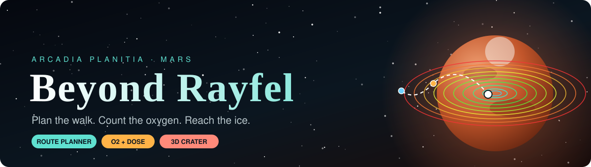

<br>


**[🌐 Live site](https://beyondrayfel.com)** &nbsp;·&nbsp; **[🚀 Quick start](#-quick-start)** &nbsp;·&nbsp; **[🗺️ Route planner guide](#tab-1--route-planner)** &nbsp;·&nbsp; **[🧊 3D crater](#tab-2--3d-elevation-view)**

</div>

<br>

> [!NOTE]
> **Beyond Rayfel** is a static website (no server, no build step, no installation) for a crewed surface mission to **Arcadia Planitia, Mars**. Its core is **`projects.html`**: explore the landing area on a real NASA map, plan an astronaut walk or rover route around **ten range circles**, check its **oxygen margin and radiation dose** (with the formulas one click away), simulate the whole **Earth → Mars → Earth** timeline, and then see and edit **the same route in 3D** on the crater. The two views are **live-linked**.

<div align="center">

| 🗺️ **Route planner** | 🫁 **O₂ and dose** | 🛰️ **Mission plan** | 🧊 **3D crater** |
|:---:|:---:|:---:|:---:|
| Drag C points along 10 D circles, add ◆ breakpoints | 8 h supply, 30 % reserve, solar-storm ×5 | 3 flight profiles, 5 launch windows, animated orbits | Same route in 3D, tilt, relief, distance and slope ruler |
| **10** D circles | **0.67** mSv/day | **600** mSv limit | **~5 m** / pixel |

</div>

<div align="center"></div>

## 📸 Gallery

<div align="center">

<table>
<tr>
<td width="50%" align="center">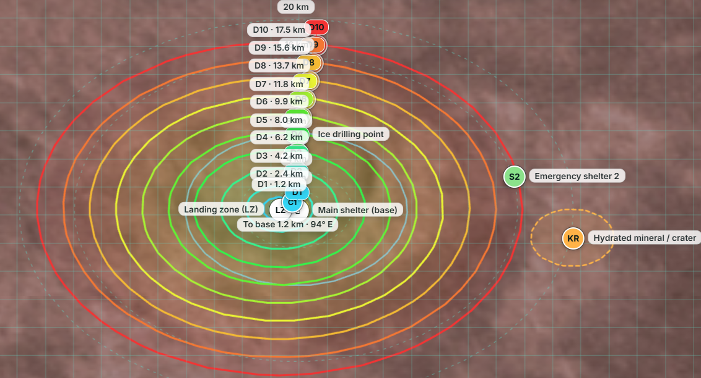<br><sub><b>Route planner:</b> D1–D10 circles, range rings, shelters and science points on the Viking map</sub></td>
<td width="50%" align="center">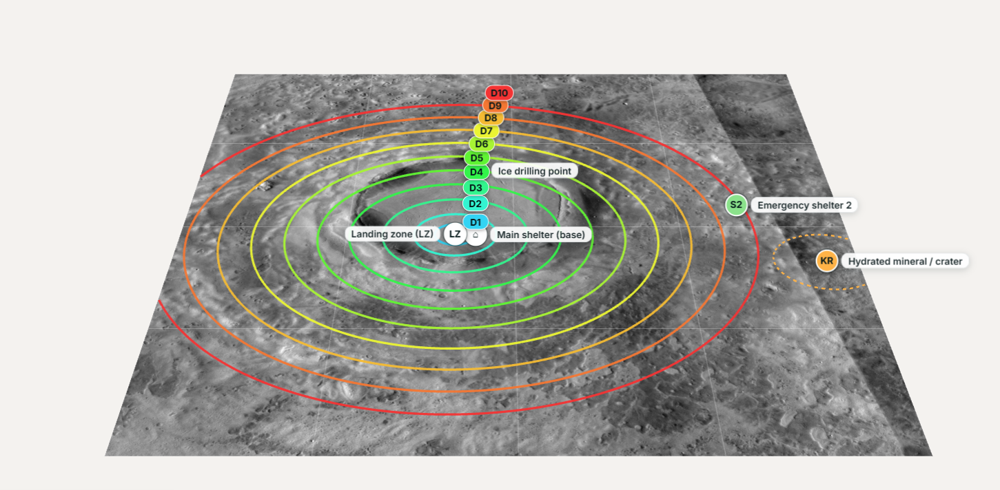<br><sub><b>3D crater:</b> the same D circles, shelters and labels draped over the orbital image</sub></td>
</tr>
<tr>
<td align="center">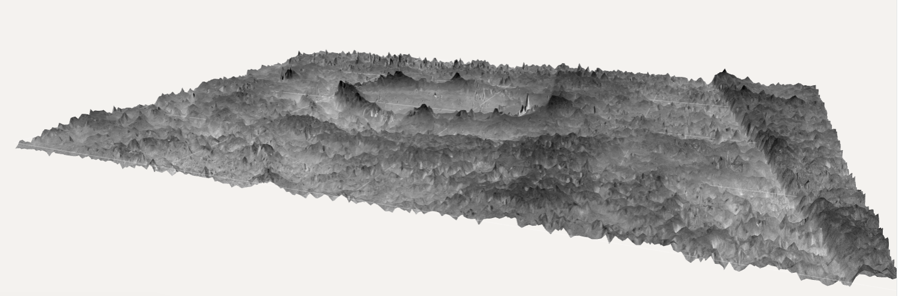<br><sub><b>3D crater:</b> illustrative relief (brightness-based, not real elevation)</sub></td>
<td align="center">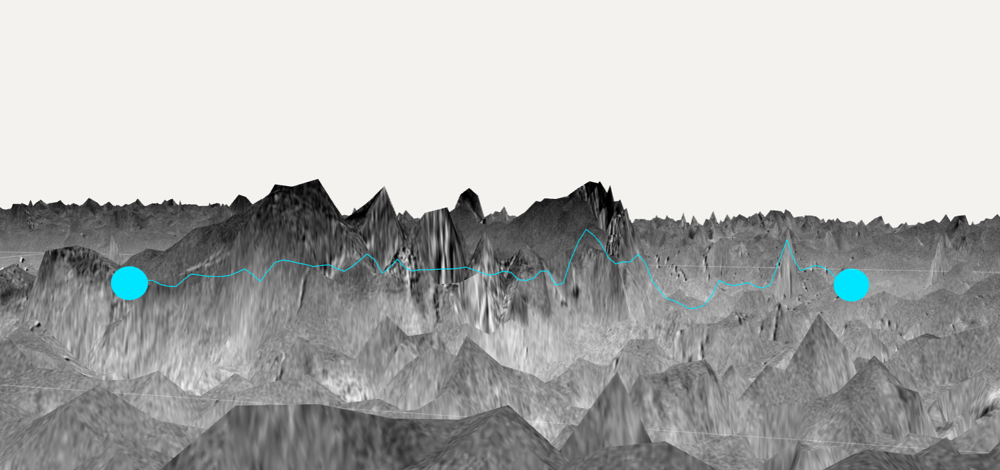<br><sub><b>3D crater:</b> a two-click measurement line that follows the relief</sub></td>
</tr>
<tr>
<td align="center">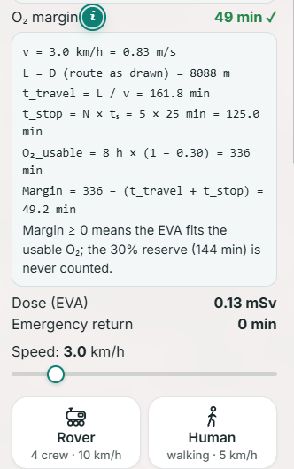<br><sub><b>Mission info:</b> O₂ margin with its formula, dose, speed presets</sub></td>
<td align="center">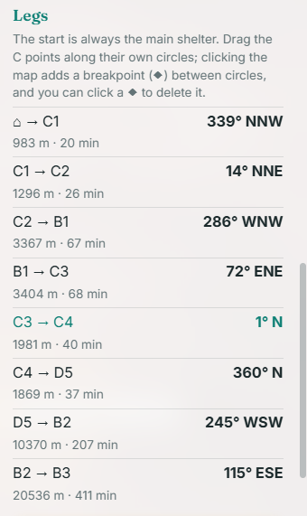<br><sub><b>Legs:</b> bearing, length and time for every segment</sub></td>
</tr>
</table>

</div>

<div align="center"></div>

## Table of contents

1. [Gallery](#-gallery)
2. [Quick start](#-quick-start)
3. [Repository structure](#-repository-structure)
4. [Site navigation](#-site-navigation)
5. [`projects.html` in depth](#%EF%B8%8F-projectshtml-in-depth)
   - [How the page is built](#how-the-page-is-built)
   - [Tab 1: Route planner](#tab-1--route-planner)
   - [Tab 2: 3D elevation view](#tab-2--3d-elevation-view)
6. [Calculation model and assumptions](#-calculation-model-and-assumptions)
7. [Data sources and technologies](#-data-sources-and-technologies)

<div align="center"></div>

## 🚀 Quick start

### Online
Open `https://beyondrayfel.com`, then click the **Project** node on the home page.

### Run locally

```bash
git clone https://github.com/AdaOzkan/BeyondRayfel.git
cd BeyondRayfel
python3 -m http.server 8000
```

Then open `http://localhost:8000/projects.html` in your browser.

> [!TIP]
> **Why not just double-click the file (`file://`)?** The Thermal, Dust and Slope overlays load local `.tif` files with `fetch`, and browsers block that on `file://`. Use any local HTTP server.

> [!IMPORTANT]
> **An internet connection is required.** Map tiles come from NASA/JPL Mars Trek; Leaflet, geotiff.js, Three.js and the fonts are loaded from CDNs.

<div align="center"></div>

## 📁 Repository structure

| File | Description |
|---|---|
| `index.html` | Landing page: an animated Mars with four nodes (Team info, Project, Resources, Contact). |
| **`projects.html`** | **The main application.** A two-tab shell containing the Route planner (Leaflet) and the 3D crater viewer (Three.js). Everything is embedded in this one file (about 8.9 MB). |
| `team.html` | Team information. |
| `resources.html` | Resources and references. |
| `contact.html` | Contact page. |
| `404.html` | "Danger Zone" error page. |
| `thermal.tif`, `dust.tif`, `slope.tif` | Local GeoTIFF overlays for the map. |
| `Nasanın insanlı mars görevleri için önerdiği yerler.xml` | Metadata of the NASA EMC "Exploration Zones" layer (metadata only, no geometry). |
| `KHInterferenceTRIAL-Regular.otf` | Display font used on the landing page (trial licence). |
| `logo.png` | Project logo. |
| `CNAME` | Custom domain for GitHub Pages (`beyondrayfel.com`). |
| `readme/` | Images used by this README: banner, divider, three diagrams (mission geometry, O₂ budget, tab sync) and the screenshots. |

<div align="center"></div>

## 🧭 Site navigation

When `index.html` opens, Mars appears with an intro animation and four nodes orbit it:

| Node | Opens |
|---|---|
| Team info | `team.html` |
| **Project** | **`projects.html`** |
| Resources | `resources.html` |
| Contact | `contact.html` |

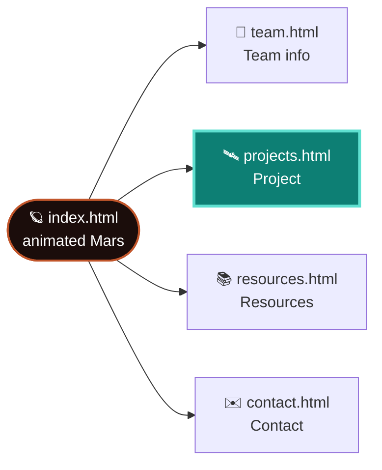

<div align="center"></div>

## 🗺️ `projects.html` in depth

### How the page is built

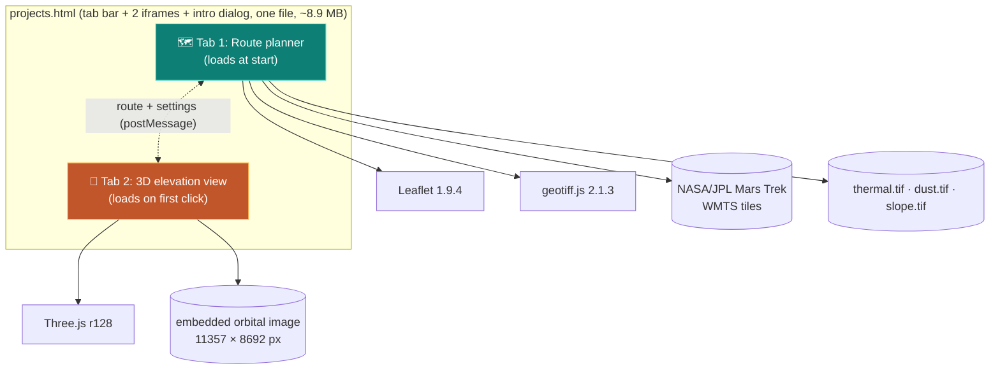

`projects.html` is a thin **shell**: a tab bar, two `<iframe>` elements and a one-time intro dialog. The two applications are stored inside the file as strings and are injected with `srcdoc`:

| Tab | What it is | Technology |
|---|---|---|
| **Route planner (Leaflet)** | 2D map, shelters, science points, range rings, D circles, route drawing, O₂ and dose calculator, mission-timeline simulator | Leaflet 1.9.4, geotiff.js 2.1.3, Canvas 2D |
| **3D elevation view** | Georeferenced 3D viewer of the Arcadia Planitia crater with the same circles, sites and route, plus a distance/slope ruler | Three.js r128, WebGL |

Things worth knowing:

- **Lazy loading.** Only the Route planner loads at start. The 3D tab loads the first time you click it, because it carries an embedded orbital image (this is why the file is about 8.9 MB).
- **Intro dialog.** The first time you open the 3D tab, a box explains that its relief is *our own system* that derives an approximate relief from image shading, not measured elevation, and that the two tabs are live-linked. Press **Begin** to continue (the tabs are locked until you do).
- **Live-linked tabs.** The shell relays the route state between the two iframes (see the next section).
- **Each tab keeps its state** when you switch away and back. Switching back only triggers a resize so the map redraws correctly.
- **Responsive layout.** On narrow screens the side panels shrink and the heading tape moves to the bottom; in the 3D tab the control panel moves below the view.
- **Bilingual strings.** All interface text exists in English and Turkish inside the code. This build starts in English and has no on-screen language switch, so everything below uses the English labels.
- **Everything runs client-side.** Nothing is uploaded; the only network traffic is tile/library/font downloads (and, for the *Layer 3* overlay, one GeoTIFF download).

#### Live link between the tabs

<div align="center">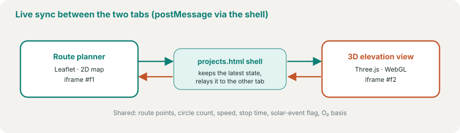</div>

Whenever you change the route or one of its settings in either tab, that tab sends its **state** to the shell, and the shell forwards it to the other tab. The other tab rebuilds the same route from it. A tab that loads later asks for the latest state when it becomes ready, so a route drawn before you ever opened the 3D tab is already there.

What is shared:

| Shared | Not shared |
|---|---|
| All route points (⌂, C points, ◆ breakpoints, return) | Map layer, overlay and opacity choices |
| Number of route circles (1–10) and the remembered positions of the unused C points | Layer visibility toggles |
| Speed, stop duration, solar particle event, O₂ margin basis | Progress marker and selected leg |

<div align="center"></div>

### Tab 1 · Route planner

#### Screen layout

```text
┌─────────────────────────────────────────────────────────────────────┐
│  Route planner (Leaflet)  │  3D elevation view                      │ ← tabs
├─────────────┬───────────────────────────────────────┬───────────────┤
│ MAP LAYERS  │        ◂ 300 ····· 330 ····· N ▸      │ MISSION INFO  │
│  Base       │               339° NNW                │  Cursor       │
│  Overlay    │               (heading tape)          │  Distance ⓘ   │
│  Opacity    │                                       │  Travel time  │
│  Custom ID  │                                       │  Science stop │
│             │            ·  ·  D10                  │  O₂ basis ▾   │
│ MISSION     │         ·  ·  D5 ◍ BZ                 │  O₂ margin ⓘ  │
│ LAYERS      │       ·  ⌂ ── LZ  ·                   │  Dose (EVA)   │
│  ☑ Shelters │         ·  ·  D1                      │  Emergency ret│
│  ☑ Rings    │            ·    ◆ ── S2               │  Speed ▬▬●▬▬  │
│  ☑ D1–D10   │                                       │  [Rover][Human]│
│  ☑ Grid …   │                                       │  Stop · SPE   │
│             │                                       │  Progress ●▬▬ │
│ LOCATIONS   │                                       │  Circles 1–10 │
│  Base …     │                                       │ LEGS + note   │
│  S2 … ✓/✗   │                                       │               │
├─────────────┴───────────────────────────────────────┴───────────────┤
│ [Add breakpoint] [Undo] [Return to base] [Reset route] [Download    │
│  JSON] [Ice EVA] [Shelter area] [Mission plan]                      │
└─────────────────────────────────────────────────────────────────────┘
```

| Area | Position | Purpose |
|---|---|---|
| **Heading tape** | top centre | Compass bearing of the current route leg |
| **Left panel** | left | Map layers, mission layers, locations list |
| **Right panel** | right | Mission info (distance, time, O₂, dose), speed controls, route settings, legs, and the "Why circles?" note |
| **Button bar** | bottom centre | Route editing, export, presets, Mission plan |
| **Map** | background | NASA Mars map with all mission geometry |

<div align="center"></div>

#### 1) Heading tape (top)

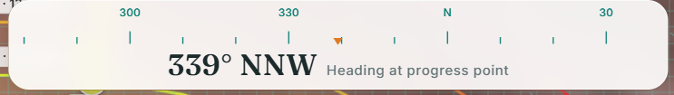

A helmet-HUD style compass.

- The big number is the **bearing in degrees plus a 16-point compass name** (for example `339° NNW`). Bearings run 0–360° with north = 0°.
- The tape shows a ±60° window around the current heading. Ticks are every 10°; labelled ticks are every 30° (`300`, `330`, `N`, `30`…). The orange triangle marks the current heading.
- The caption next to the number says which heading you are looking at:
  - **"Heading at progress point"**: the bearing of the leg the *Progress along route* slider is currently on.
  - **"Selected leg"**: the bearing of a leg you clicked in the Legs list (see below).
- With no route it shows `—` and "Add a route for heading".

<div align="center"></div>

#### 2) Left panel · Map layers

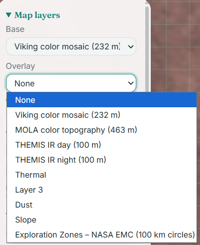

| Control | What it does |
|---|---|
| **Base** | The map underneath. Choices: *Viking color mosaic (232 m)* and *MOLA color topography (463 m)*. |
| **Overlay** | A second layer drawn on top of the base (the screenshot shows the open list; details below). |
| **Opacity** | Overlay transparency, 0–100 (default 55). |
| **Custom layer ID** | Add your own layer. Paste a tile URL (`…/z/y/x.png`) or a Mars Trek layer ID, type the **maximum native zoom** in the small number box (1–12, default 7), and press **Add**. It appears in the Overlay list as "Custom: …" and is selected immediately. |

<details>
<summary><b>🧩 Overlay options (click to expand)</b></summary>

| Overlay | Source / note |
|---|---|
| None | Overlay off. |
| Viking color mosaic (232 m) | Mars Trek WMTS |
| MOLA color topography (463 m) | Mars Trek WMTS (elevation colour shading) |
| THEMIS IR day (100 m) | Mars Trek WMTS (infrared, daytime) |
| THEMIS IR night (100 m) | Mars Trek WMTS (infrared, night-time) |
| Thermal | Local `thermal.tif` (GeoTIFF) |
| Layer 3 | GeoTIFF fetched from Google Drive. If it cannot be read, the panel shows the error and a **Choose file** button so you can pick the downloaded file manually. |
| Dust | Local `dust.tif` |
| Slope | Local `slope.tif` (terrain slope) |
| Exploration Zones – NASA EMC (100 km circles) | Candidate human-landing zones from NASA's 2015 workshop (Jezero, Gale, Mawrth Vallis, Oxia Planum, Eberswalde, Melas Chasma, Arcadia Planitia), each drawn as a 100 km circle. Selecting it zooms out to a global view. Positions are approximate. |

GeoTIFF overlays are read in the browser, drawn to a canvas (4096 px on the long side) and placed on the map by their geographic bounds. If a file has no readable coordinates in degrees, the page asks you to type the bounds (`west,east,south,north`).

</details>

> If a layer's tiles fail to load (8 failed tiles in a row), the panel shows "This layer's tiles are not loading; the ID may differ on this service. Pick another layer or enter a custom ID."

<div align="center"></div>

#### 3) Left panel · Mission layers

Check boxes switch parts of the mission geometry on and off:

| Toggle | What it controls |
|---|---|
| Shelters & landing | Main shelter, landing point, Emergency shelter 2 |
| Science points | Ice drilling point, Hydrated mineral / crater |
| Range rings (from base) | Rings at 2, 4, 8, 16 and 20 km around the base |
| Zone circles | The orange crater / mineral area circle |
| D1–D10 circles (LZ-centered) | The ten colour-coded circles around the landing zone |
| Labels | All permanent text labels (turn off to declutter) |
| Lat/lon grid | Latitude/longitude lines; spacing adapts to zoom |
| Route | The dashed route line |

The **Hide all / Show all** button at the top switches every layer at once (and hides markers, labels and popups). Ticking any box again brings the markers back.

<div align="center"></div>

#### 4) Left panel · Locations

A clickable list of the main sites. Each row shows the name, coordinates, **distance and bearing from the base**, and for every site farther than 100 m a **walking round-trip check**:

> `walking round trip 3 h 41 min ✓` or `… ✗ rover`

The time is `2 × distance ÷ speed + one stop`. A green ✓ means it fits inside the usable oxygen budget (5.6 h = 336 min) at the **current speed and stop duration**; a red **✗ rover** means you would need the rover. The list recalculates whenever you move the speed or stop-duration controls.

Clicking a row flies the map to that site (zoom ≥ 11) and opens its popup. Clicking the base opens the habitat diagram.

<div align="center"></div>

#### 5) The map


<div align="center">
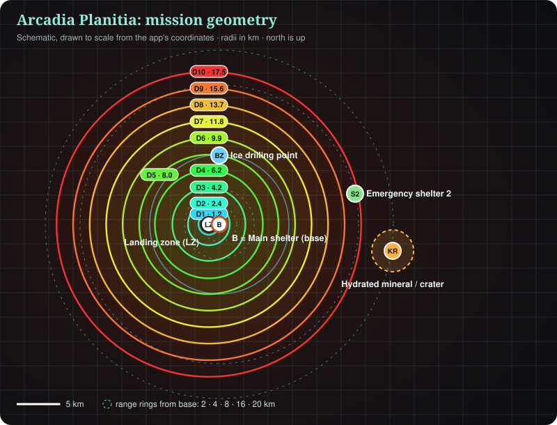
<br><sub><b>Mission geometry, drawn to scale from the coordinates in the code:</b> ten D circles around the landing zone, range rings around the base, and the shelters and science points.</sub>
</div>

What you see on the map:

| Element | Meaning |
|---|---|
| **⌂ Main shelter (base)** | Where every route starts. 46.560°N, 173.005°W. **Click it to open the underground-habitat diagram.** |
| **Landing point** | Dashed orange marker right next to the base (46.560°N, 173.00468°W). |
| **LZ · Landing zone** | Centre of the D1–D10 circles (46.56126°N, 173.03432°W), about 1.2 km west of the base. A dashed white line links it to the base and is labelled with the distance and bearing (`To base 1.2 km · 94° E`). |
| **S2 · Emergency shelter 2** | Far-range backup shelter (46.620°N, 172.620°W), about 16 km from the base. |
| **BZ · Ice drilling point** | Ice-drilling science point on the 8 km ring (46.695°N, 173.005°W). |
| **KR · Hydrated mineral / crater** | CRISM hydrated-mineral / ice signature with a HiRISE boulder map (46.510°N, 172.515°W); shown as a dashed circular area of about 3 km radius. |
| **D1 … D10 (coloured circles)** | Ten circles centred on the LZ, radii 1.2, 2.4, 4.2, 6.2, 8.0, 9.9, 11.8, 13.7, 15.6 and 17.5 km. Colour runs from cyan to red as distance grows. Each has a labelled chip and a radius label (`D5 · 8.0 km`). |
| **Thin dashed circles** | Range rings from the base at 2, 4, 8, 16 and 20 km (the 8 km ring is drawn in blue). |
| **Grid** | Lat/lon lines at 5° → 0.5° → 0.05° → 0.01° spacing, depending on zoom. |

**Popups**

- **Site popup** (S2, BZ, KR, landing point): name, coordinates, distance and bearing from base, a short description, and an **Add to route** button that inserts that site into your route as a breakpoint.
- **D-circle popup** (click a chip or a C marker): name, coordinates, distance to the LZ and circle radius, distance and bearing from the base, a one-line purpose, a list of **planned science activities**, a verification note, and the "Why circles?" explanation.

**What each D circle is for**

| Circle | Radius | Purpose |
|---|---|---|
| D1 | 1.2 km | **Main shelter (habitat) zone.** Base set-up and near-field survey; the shortest, safest EVA ring. |
| D2 | 2.4 km | **Soil and rock analysis.** Physical and chemical characterisation of regolith and boulders. |
| D3 | 4.2 km | **Crater morphology and topography.** Walls, terraces, ridges and debris deposits. |
| D4 | 6.2 km | **Mineral and spectral analysis.** Ground-truthing hydrated minerals and exposed-material signatures. |
| D5 | 8.0 km | **Ice drilling.** The mission's main ISRU target: confirming subsurface water ice. |
| D6 | 9.9 km | **Ice–regolith stratigraphy.** Terraced craters and viscous-flow-like features; a second GPR/drill line. |
| D7 | 11.8 km | **Volcanic units and geology.** Field verification of Arcadia Formation / Amazonian lava units. |
| D8 | 13.7 km | **Environment and radiation station.** Fixed station for local atmosphere and dose data. |
| D9 | 15.6 km | **Emergency shelter 2 and forward depot.** Backup life support and fallback for long EVAs. |
| D10 | 17.5 km | **Outer limit and reference point.** Widest ring: rover-supported exploration and comparison samples. |

Each popup also carries a short verification note, for example that SHARAD and literature evidence is regional and ice thickness has not been measured at that spot (D5), or that no direct RAD measurement exists at Arcadia so the D8 station would give the first local data.

<div align="center"></div>

#### 6) Why circles, not a straight route?

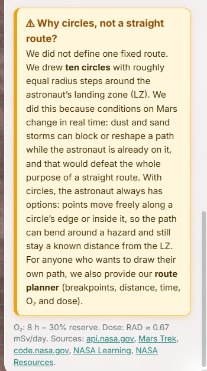

The yellow note at the bottom of the right panel (and inside every D-circle popup) explains the design choice. There is **no single fixed route**. Conditions on Mars change in real time: dust and sand storms can block or reshape a path while the astronaut is already on it. With circles the astronaut always has options: points move freely along a circle's edge or inside it, so the path can bend around a hazard and still stay a known distance from the LZ. Anyone who wants to draw their own path uses the **route planner** (breakpoints, distance, time, O₂ and dose).

<div align="center"></div>

#### 7) The habitat diagram

Click the **⌂ Main shelter** marker (or its row in the Locations list) to open a full-screen schematic titled *"Mars Underground Habitat: New Entry and Renewable Hydrogen Heating System"*. It shows:

- the **integrated entry module**: surface airlock door → pressurised entry tunnel → decontamination & action zone → inner pressure door,
- a **light-transmitting glass area** and the cosmic-radiation hazard above ground,
- the **subsurface ice source** feeding **water electrolysis**, the **hydrogen storage tank**, the **hydrogen fuel cell and heating system**, and the **heating loop** (hot water/air),
- a text explanation of each step: ice → electrolysis (H₂ + O₂) → fuel cell (heat + electricity) → heat distribution, with clean water and breathable oxygen as by-products.

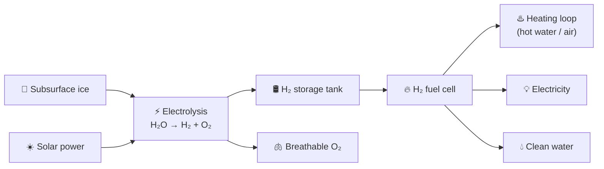

Close it with the ✕ button, by clicking outside the box, or with **Esc**.

<div align="center"></div>

#### 8) Right panel · Mission info

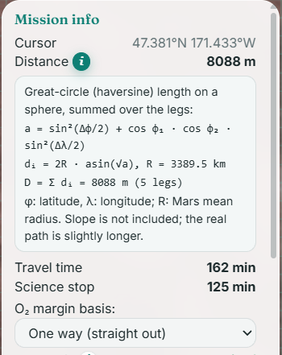

This panel updates live while you build a route.

| Field | Description |
|---|---|
| **Cursor** | Latitude/longitude under the mouse pointer. |
| **Distance ⓘ** | Total route length in metres (great-circle / haversine). Click **ⓘ** to see the formula and the number of legs. Slope is not included, so the real path is slightly longer. |
| **Travel time** | Time to cover that distance at the chosen speed. |
| **Science stop** | Total time spent at circle points (`number of C/D points × stop duration`). |
| **O₂ margin basis** | *One way (straight out)* counts the route as drawn; *Round trip (same route back)* doubles the distance up to the last outbound point. |
| **O₂ margin ⓘ** | Oxygen time left after the EVA. Green ✓ is safe; red ✗ means you run out. Click **ⓘ** for the exact calculation with your numbers filled in. When negative, a warning gives the shortfall in minutes and tells you to shorten the route or reduce stop time. |
| **Dose (EVA)** | Estimated radiation dose for the EVA, in mSv. |
| **Emergency return** | Time to walk back to the base **in a straight line from the current progress marker**, at the current speed. |
| **Speed** | Slider, 1–15 km/h in 0.5 steps (default 3.0). |
| **Rover / Human** | One-tap presets. **Rover** = 10 km/h (4 crew), **Human** = 5 km/h (walking). The active preset is highlighted; the slider stays freely adjustable. |
| **Stop duration (min/circle)** | Time spent at each C/D point (0–90 min, default 25). |
| **Solar particle event (×5 dose)** | When ticked, the dose is multiplied by 5 and a warning appears: *"Warning: shorten the EVA, return to the shelter."* |
| **Progress along route** | Slider that moves a red marker along the route. The heading tape and *Emergency return* follow this marker. |
| **Route circles (1–10)** | How many circles the route visits (default 5). Changing it rebuilds the route. |

The **ⓘ** buttons show the model in the panel itself, so the numbers are never a black box:

<div align="center">

&nbsp;&nbsp;
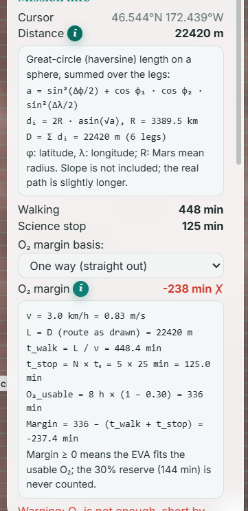
<br><sub><b>Left:</b> a safe route (margin +49 min ✓). <b>Right:</b> a 22.4 km route whose margin is −238 min ✗ (this older capture labels the row "Walking"; the final build calls it "Travel time").</sub>
</div>

<div align="center">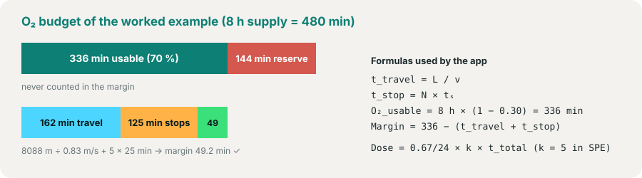</div>

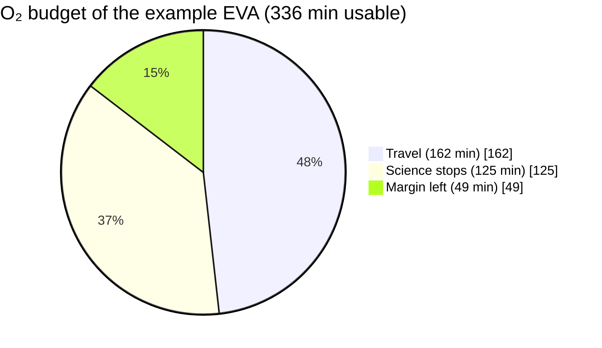

**Worked example (from the screenshots)**: 8088 m at 3 km/h with 5 circle stops of 25 min.

- Travel: 8088 m ÷ 0.83 m/s ≈ **162 min**
- Science stops: 5 × 25 = **125 min**
- Total EVA time: 287 min
- Usable O₂: 8 h × 0.70 = 336 min → margin **336 − 287 = 49 min ✓**
- Dose: 0.67 mSv/day ÷ 24 h × 287 min ≈ **0.13 mSv**

<div align="center"></div>

#### 9) Right panel · Legs


The **Legs** list breaks the route into segments. Each row shows *from → to*, the **bearing (degrees + compass name)**, the **length** and the **travel time**:

- `⌂ → C1`: base to first circle, 983 m · 20 min, **339° NNW**
- `C1 → C2`: 1296 m · 26 min, **14° NNE**
- `C2 → B1`: 3367 m · 67 min, **286° WNW** (a breakpoint)
- …

Click a row to **select** that leg (it turns green). The heading tape then shows that leg's bearing ("Selected leg") instead of following the progress slider.

Point labels used in the list:

| Label | Meaning |
|---|---|
| `⌂` | Main shelter (start, or return point) |
| `C1 … Cn−1` | Circle points; each one sits on its own D circle |
| `Dn` | The route's final circle point (labelled with the circle number it lies on) |
| `B1, B2 …` | Breakpoints (◆) you added by clicking the map |

<div align="center"></div>

#### 10) How route drawing works

A route is built from **three kinds of points**:

1. **Start ⌂**: always the main shelter. It cannot be moved.
2. **Circle points C1…Cn**: one point on each of the first *n* D circles. By default they sit on the 45° bearing from the LZ for the first circle and at the preset positions for the rest. **Drag a C point and it slides only along its own circle**, so its distance from the LZ stays fixed and you choose the direction. Circles beyond *n* show **semi-transparent "ghost" C points** that you can also drag; their positions are remembered and used when you raise the circle count.
3. **Breakpoints ◆**: free points you add by clicking the map. With **Add breakpoint** on, a click inserts the ◆ between the two circle points whose circles it falls between (decided by its distance from the LZ), and on the nearest segment of that stretch. Drag a ◆ anywhere; click it and press **Delete** in its popup to remove it.

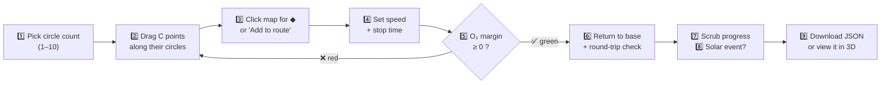

**Step by step**

1. Choose the number of **Route circles** (1–10).
2. **Drag the C points** around their circles to pick directions.
3. Optionally **click the map** to add ◆ breakpoints (to avoid an obstacle, for example), or use **Add to route** in a site popup to go via the ice-drilling point, shelter 2 or the crater.
4. Set **Speed** (or tap Rover / Human) and **Stop duration**.
5. Check **O₂ margin**. If it is red, shorten the route, raise the speed or cut the stop time.
6. Press **Return to base** to append the way home, and set *O₂ margin basis* to **Round trip** to verify the full excursion.
7. Drag **Progress along route** to inspect headings and the emergency-return time at any point.
8. Optionally tick **Solar particle event** to see the worst-case dose.
9. Press **Download JSON** to save the route, or switch to the **3D elevation view** tab to see the same route on the crater.

<div align="center"></div>

#### 11) Button bar (bottom)

| Button | What it does |
|---|---|
| **Add breakpoint** | Toggle (on by default). When on, clicking the map adds a ◆. When off, map clicks do nothing to the route. |
| **Undo** | Removes the most recently added point. |
| **Return to base** | Appends the main shelter as the final point (`⌂`). Does nothing if the route already ends there. |
| **Reset route** | Restores the default route and C positions. |
| **Download JSON** | Saves the route as `marswalk-rota.json` (format below). |
| **Ice EVA** | One-click demo: builds a 5-circle route, adds the return to base and fits the view to the shelter area. |
| **Shelter area** | Zooms the map to fit all shelters and science points. |
| **Mission plan** | Opens the Earth → Arcadia Planitia → Earth mission simulator. |

<details>
<summary><b>💾 <code>marswalk-rota.json</code> format (click to expand)</b></summary>

```json
{
  "landing_zone": { "lat": 46.56126, "lon": -173.03432 },
  "waypoints": [
    { "id": "base",        "type": "base", "lat": 46.56,    "lon": -173.005   },
    { "id": "C1",          "type": "ring", "lat": 46.5694,  "lon": -173.0381  },
    { "id": "B1",          "type": "bend", "lat": 46.5811,  "lon": -173.0402  },
    { "id": "D5",          "type": "end",  "lat": 46.695,   "lon": -173.005   },
    { "id": "base_return", "type": "ret",  "lat": 46.56,    "lon": -173.005   }
  ],
  "distance_m": 8088,
  "source": "NASA/JPL Mars Trek"
}
```

(Waypoint coordinates here are illustrative; the real file contains your own route. `landing_zone` is the LZ, the centre of the D circles.) Point `type` values are `base`, `ring`, `end`, `bend` and `ret`. The 3D tab exports the same format and file name.

</details>

<div align="center"></div>

#### 12) Mission plan (full-screen simulator)

The **Mission plan** button opens a full-screen window: *"Mission plan: Earth → Arcadia Planitia → Earth"*.

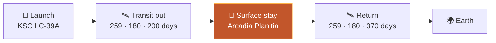

<sub>The three numbers are the three profiles: low energy, fast transit and short stay (Venus swing-by).</sub>

**Inputs**

| Control | Options |
|---|---|
| **Profile** | **Low energy, long stay**: 259-day transit each way, surface stay derived from planetary alignment (about 454 days at the default opposition, about 972 days in total). **Fast transit**: 180 days each way (about 553 days on the surface, about 913 in total). **Short stay**: 200 days out, 30 days on the surface, 370 days back with a Venus swing-by (600 days total). |
| **Opposition** (Mars closest to Earth) | 25 Mar 2029, 4 May 2031, 27 Jun 2033, **15 Sep 2035 (default)**, 19 Nov 2037. The launch date is computed relative to the chosen opposition. |
| **Mission day** | Slider from day 0 to the end of the mission. |

**Outputs**

- **Orbit animation (canvas):** the Sun, Earth's orbit (1 AU) and Mars's orbit (1.524 AU), Earth (blue), Mars (red) and the spacecraft. The full path is drawn dashed; the part flown so far is solid. Under it, the current **date**, the **phase** (*Earth→Mars transit*, *On the Mars surface (Arcadia Planitia)* or *Mars→Earth return*) and the current **Earth–Mars distance** in million km.
- **Summary table:** Launch (KSC), Arrival at Mars, Surface stay, Departure from Mars, Return to Earth, Total mission, Earth–Mars distance at opposition (AU and million km), and **Estimated dose (flight + surface)** with a ✓ or ✗ against the 600 mSv limit. With the built-in dose rates (1.84 mSv/day in flight, 0.67 mSv/day on the surface) all three profiles come out above 600 mSv and are flagged ✗; the model is meant to show that this limit is a design constraint, not a solved problem.
- **Plan items:** a numbered explanation covering the launch (Kennedy Space Center LC‑39A, LEO assembly, trans-Mars injection, NASA Worldview for weather), transit time, the landing site (crater at about 46.62°N, 173.03°W, about −3.9 km elevation; why near-surface ice makes it attractive for ISRU), the return, **habitat pros and cons** (elevation and ice vs. weak winter solar power, CO₂ frost, dust storms, 3–22 min one-way communication delay), research goals, survival requirements (O₂ about 0.84 kg/person/day, water recycling, nuclear + solar power, radiation shelter), and how the project fits the challenge criteria.
- **Back to map** (or the ✕ button) closes the window.

> [!NOTE]
> The model uses simple circular, coplanar orbits. Real dates can shift by a few weeks and the Venus swing-by path is schematic. Verify exact values with JPL Horizons.

<div align="center"></div>

### Tab 2 · 3D elevation view

The **3D elevation view** tab shows the Arcadia Planitia crater from an orbital image (11357 × 8692 px, about 5.0 m/pixel north–south and 3.4 m/pixel east–west, covering 43.4 km north–south × 39.0 km east–west) on a 3D surface, with a real latitude/longitude read-out. On top of the image it draws **the same circles, sites and route as the Route planner**, and you can edit the route right on the terrain.

<div align="center">

<br><sub>Tilted view with relief 0: the D1–D10 circles, LZ, base, ice drilling point, shelter 2 and the KR zone sit on the orbital image.</sub>
</div>

#### Control panel (right side)

| Group | Control | What it does |
|---|---|---|
| **View** | **Tilt** | Tilts the camera from 0° (straight down) to 90°. |
| | **Illustrative relief** | Adds relief to the surface, 0–12 in 0.5 steps. Higher values exaggerate the shapes. |
| **Markers and layers** | **Crater center** | Shows/hides the orange ring at the crater centre (46.6249°N, 173.0323°W). |
| | **Grid** | Shows/hides the white reference grid. |
| | **D1–D10 circles · Range rings · Zone circle · Sites · Route · Labels** | Same layer switches as the Route planner. |
| **Route planner** | Route circles, Undo, Return to base, Reset route, Download JSON | Same actions as in the map tab. |
| | Speed, Rover / Human, Stop duration, O₂ margin basis, Solar particle event | Same inputs; the panel shows Distance ⓘ, Travel time, Science stop, O₂ margin ⓘ, Dose and the Legs list. |
| **Measure** | **Clear** | Removes the two measurement points. |
| | **Reset view** | Returns the camera to its default position, zoom and zero tilt. |

#### Click mode bar (bottom right of the view)

| Mode | What a click does |
|---|---|
| **Plan route** (default) | Clicking the terrain adds a ◆ breakpoint between the circles, exactly like the map tab. Drag a C point along its circle, drag a ◆ anywhere, **double-click a ◆ to delete it**. |
| **Measure** | Clicking places measurement points (see below). The cyan markers and line are only visible in this mode. |

#### With illustrative relief


Raising *Illustrative relief* lifts the surface according to image brightness, making the crater walls and surrounding terrain stand out. This is the system the intro dialog describes: Mars Trek's default GeoTIFFs do not give a 3D view of this crater, so the relief is derived from image shading.

> [!WARNING]
> **This relief is not measured elevation.** It is derived from image brightness (shadows read as low). Use it only to read shapes. For real elevation analysis use MOLA/HRSC DEM data.

#### Measuring distance and slope


1. Switch the click mode to **Measure**.
2. Click **two points** on the surface. Cyan markers appear, joined by a line that **follows the relief**.
3. The panel shows:
   - **Distance** in km and m,
   - **Bearing** from north (°),
   - **Rel. height change** in metres,
   - **Mean slope** and **Max slope**, each in % and degrees.
4. A third click starts a new measurement; **Clear** also resets it.

Heights and slopes come from the illustrative relief, so they depend on the *Illustrative relief* setting (the panel says so). Horizontal distances use the Mars sphere (R = 3389.5 km) and the image's geographic scale (about 8.4 × 10⁻⁵ degrees per pixel).

#### Read-out and mouse controls

The box at the bottom-left follows the mouse and shows **latitude, longitude, pixel coordinates and brightness (0–255)** at the pointer.

| Action | Result |
|---|---|
| Drag with left button | Pan the view |
| Drag with right button | Rotate and tilt |
| **Shift** + left drag (when tilted) | Rotate and tilt |
| Scroll wheel | Zoom in / out |
| Click | Add a ◆ (Plan route mode) or place a measurement point (Measure mode) |
| Hover | Latitude / longitude / pixel / brightness read-out |

<div align="center"></div>

## 🧮 Calculation model and assumptions

| Parameter | Value |
|---|---|
| Mars radius (EVA distances) | 3389.5 km |
| Distance formula | Haversine (great circle); slope not included |
| Bearing | Initial compass bearing, 0–360°, north = 0° |
| O₂ supply | 8 hours, **30 % reserve** held back (usable 5.6 h = 336 min) |
| Margin | `336 − (L ÷ v + N × stop time)` in minutes; L is the route as drawn (one way) or twice the distance to the last outbound point (round trip) |
| Surface dose rate | ≈ **0.67 mSv/day** (RAD measurements at Gale crater used as a reference) |
| EVA dose | `0.67 ÷ 24 × k × total EVA hours` mSv, with k = 5 during a solar particle event |
| Mission-plan transit dose | 1.84 mSv/day in transit and return, 0.67 mSv/day on the surface |
| Total mission dose limit | 600 mSv |
| Rover speed | 10 km/h (4 crew) |
| Walking speed | 5 km/h |
| Default speed | 3 km/h (slider 1–15 km/h) |
| Default stop time | 25 min per circle (0–90) |
| Emergency return | Straight-line distance from the progress marker to the base ÷ current speed |
| Orbit model | Circular, coplanar orbits at 1 AU and 1.524 AU |
| 3D relief | `(0.5 − brightness) × relief setting`; illustrative only |

<div align="center"></div>

## 📚 Data sources and technologies

**Data**
- [NASA/JPL Mars Trek](https://trek.nasa.gov/mars/): Viking, MOLA and THEMIS layers via WMTS
- NASA Evolvable Mars Campaign (EMC) Exploration Zones
- RAD dose measurements at Gale crater (dose reference)
- CRISM, HiRISE and SHARAD observations (science-point rationale)
- An orbital image of the Arcadia Planitia crater (embedded in the 3D tab)

**Libraries (loaded from CDNs)**
- [Leaflet 1.9.4](https://leafletjs.com/): map engine (EPSG:4326)
- [geotiff.js 2.1.3](https://geotiffjs.github.io/): reads the `.tif` overlays
- [Three.js r128](https://threejs.org/): 3D viewer
- Google Fonts: Inter, Fraunces, IBM Plex Mono

<div align="center"></div>

## 👥 Team and contact

See `team.html` for the team and `contact.html` for contact details.
